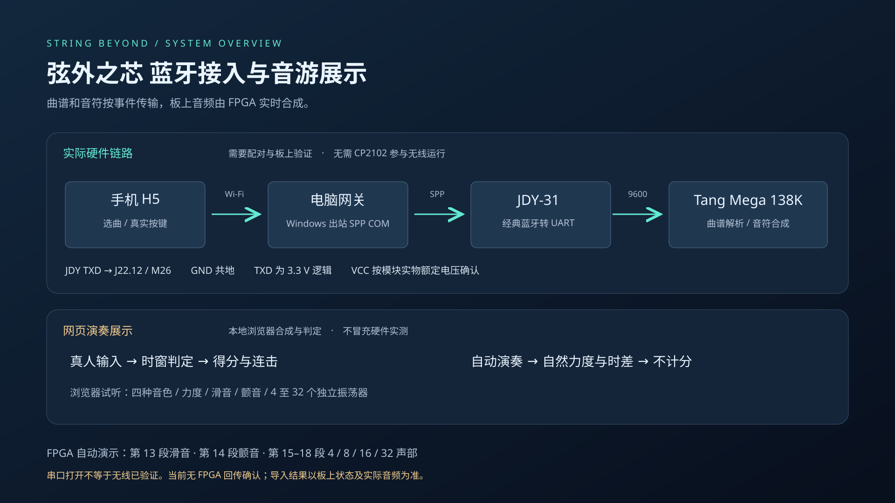

# 弦外之芯 · 多音色交互电子乐器

基于 Tang Mega 138K Pro（GW5AST-138C）的 FPGA 音频与可视化工程，包含 32 声部合成、力度与滑音表达、效果器、LCD 波形/频谱/李萨如显示，以及手机曲谱控制台和网页音游。



## 从这里开始

| 内容 | 路径 |
| --- | --- |
| FPGA 主工程、约束与 ROM | [fpga/](fpga/) |
| 手机控制台、真实按键音游与自动演奏 | [fpga/phone_app/](fpga/phone_app/) |
| JDY-31 接线与无 CP2102 联调 | [接线指南](docs/bluetooth.md) |
| 官方要求与验证对应 | [requirements.md](docs/requirements.md) |
| 构建与版本边界 | [build-status.md](docs/build-status.md) |
| 原始回归结果 | [verification/](verification/) |

## 演示与交互

FPGA 自动演示共 26 段、632 秒，涵盖力度、选音、和弦、四种音色、效果器、滑音、颤音、4/8/16/32 声部、三类音频可视化、曲谱导引与 UART 内部回环。段落数据见 [showcase_stages.json](fpga/showcase_stages.json)。S1 短按停留当前段，S2 跳段、长按约 0.6 秒重开，S3 临时切换页面。自动输入由 TEST INPUT 标识。

手机控制台支持真实浏览器按键判定、自然演奏预览和串口连接选择。自动演奏不生成真人成绩；浏览器声音实验与 FPGA 音频分别验证。当前蓝牙演奏入口跟踪单个音符，不能把网页 32 振荡器试听称为蓝牙 32 复音实测。

## 启动手机控制台

需要 Python 3（已验证 Python 3.11 及以上运行环境）；仓库附 pyserial 3.5 及其许可证。

```bash
python fpga/phone_app/gateway.py
```

也可在 Windows 双击 `fpga/phone_app/启动手机控制台.bat`。打开命令窗口输出的完整带访问码地址。默认离线预览；真实串口须由操作者选择并连接。手机与电脑在同一 Wi-Fi。

新 JDY-31 常见出厂 UART 为 9600/8N1，本版源码默认 9600；旧交付位流为 115200，两者不能混用。TXD → J22.12 / M26，GND → J22.3 或 J22.4。供电须先核实模块底板额定电压，FPGA 输入为 3.3 V 逻辑。

## 构建 FPGA

使用 Gowin V1.9.12.04 与本机合法许可证。打开 `fpga/music_pro.gprj`，或在 `fpga` 目录运行：

```text
gw_sh run_all.tcl
```

Windows 也可修改 `fpga/build.bat` 的 GW_SH 工具路径后运行。ROM 路径相对工程根目录，必须在 `fpga` 中构建。生成文件为 `fpga/impl/pnr/music_pro_showcase.fs`。

当前提交包含最新 9600 源码；其完整布局布线仍在运行，尚未发布匹配的新位流和时序结论。仓库不混入旧 115200 位流。完成构建后须核对报告再烧录，详见构建状态页。

## 复现测试

安装 Icarus Verilog 和 Node.js，Python 无需额外依赖即可运行以下单元测试：

```bash
python tools/run_rtl.py
python -m unittest discover -s fpga/phone_app -p test_gateway.py -v
node fpga/phone_app/test_rhythm.cjs
```

RTL 脚本优先读取 PATH，也支持 `IVERILOG` / `VVP` 环境变量。验证记录为 31 项 RTL 回归、19 项网关测试、7 项音游判定测试和 9 项浏览器场景。浏览器场景记录来自本地 Edge 执行，未配置 GitHub Actions。串口测试使用内存替身，不代表实际无线验收。

## 文件与许可

源码、ROM、工程约束及测试均随仓库提供；实拍原片、签字授权书、个人工具许可证与安装缓存不进入本仓库。完整历史/硬件设计档案在比赛提交代码包中单独保留，不把独立 16 声部 LED 工程算作当前 32 声部顶层的已集成功能。

第三方组件保留其声明，见 [THIRD_PARTY_NOTICES.md](THIRD_PARTY_NOTICES.md)。本次上传没有替权利人添加新的整体开源许可证。
